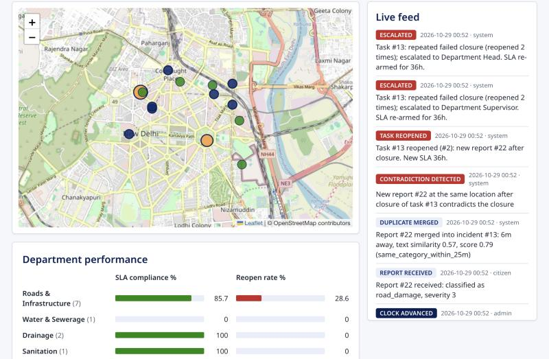
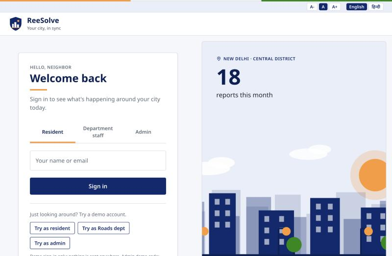
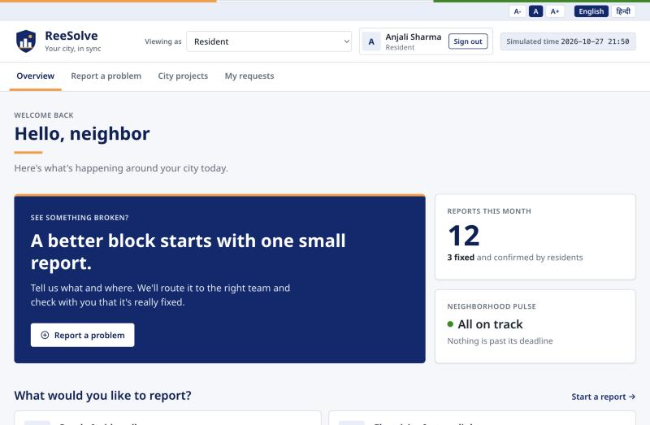
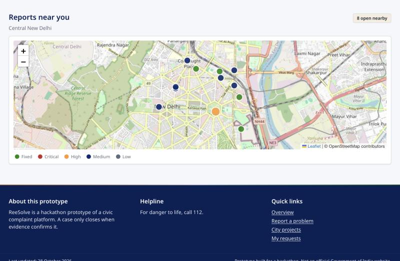
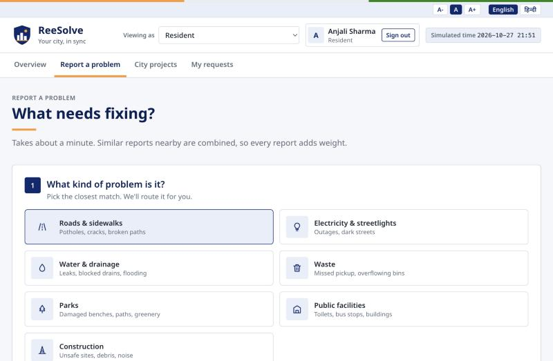
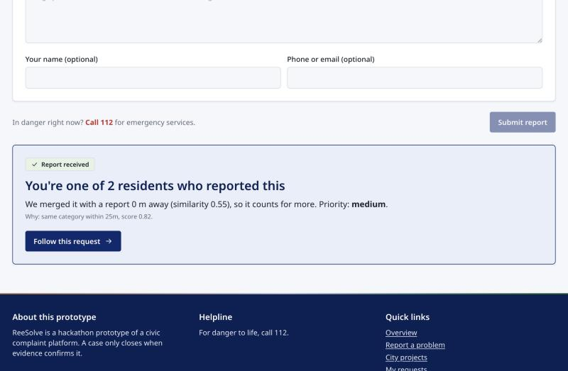
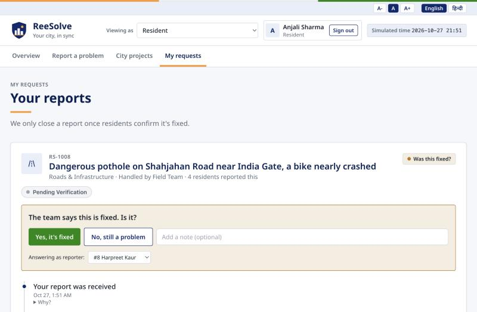
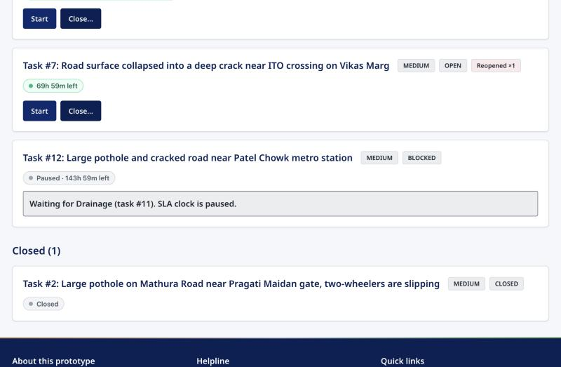
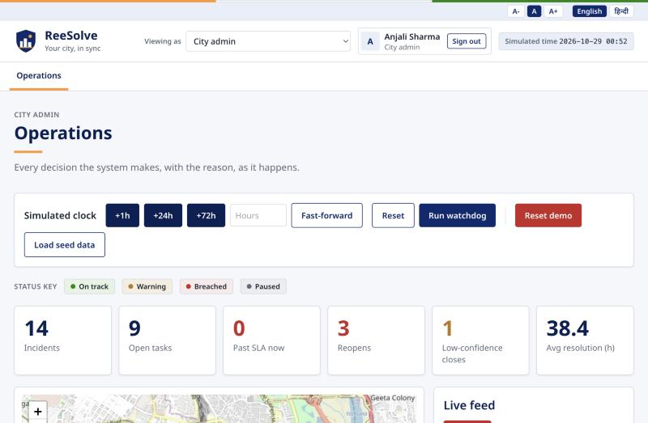
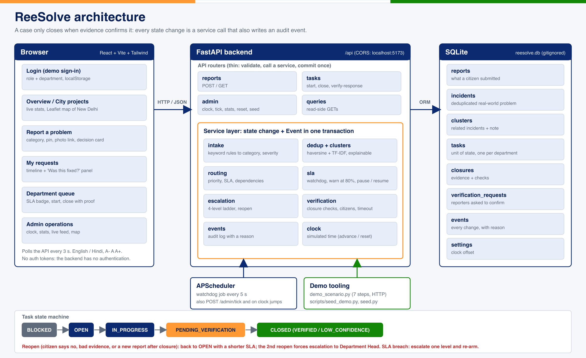

# ReeSolve

**A complaint isn't resolved when a department says so. It's resolved when the evidence agrees.**

A closed-loop civic complaint platform, built as a hackathon prototype for *Smart Cities: From Citizen Reports to
Verified Resolution*. It merges duplicate reports, links related problems across departments, tracks service-level
deadlines, and **reopens or escalates a case automatically** when a department misses a deadline or the evidence
contradicts a closure.

> **Prototype.** Built for a hackathon. It is not an official Government of India website and uses no state emblem.
> It runs on SQLite with simulated citizen verification, no real SMS or email, and a demo-only sign-in.

## Live demo

| | |
|---|---|
| **App** | <https://ree-solve.vercel.app> (frontend on Vercel) |
| **API** | <https://reesolve-api-lvvy.onrender.com> (backend on Render; interactive docs at [`/docs`](https://reesolve-api-lvvy.onrender.com/docs)) |

Open the app and use a one-click **Try as resident / Roads dept / admin** account (nothing to register). The admin
page has *Reset demo* and *Load seed data* to start the storyline fresh.

> The backend runs on Render's free tier: it **sleeps after about 15 minutes idle**, so the first request can take
> 30 to 60 seconds, and its data resets to the demo baseline whenever it restarts. Deployment details are in
> [`docs/deployment.md`](docs/deployment.md).



## 1. What problem does it solve, and for whom?

**The problem.** In most complaint systems a ticket is "closed" the moment a department says it is. Nobody checks.
Meanwhile the same pothole is reported five times as five tickets, the water leak and the road damage it caused sit
with different departments that never talk, and deadlines are missed without anyone noticing.

**Who it is for.**

| Who | What ReeSolve gives them |
|---|---|
| **Residents** | Report in a minute; see plain-language progress; get asked *"Was this fixed?"* before a case closes |
| **Department staff** | One queue sorted by SLA urgency, clear "waiting for another team" banners, a closure form that demands proof |
| **City administrators** | A live map and audit feed, SLA and reopen rates by department, and automatic escalation instead of chasing |

## 2. What it does

- **Intake:** free text plus a map pin becomes a category, severity and summary (keyword rules, fully offline).
- **Explainable duplicate detection:** five reports of one pothole become one incident. Every merge stores its
  distance, text similarity, score and rule, and the UI shows them.
- **Cross-department dependencies:** a water leak next to a pothole creates a cluster. The Roads task is *blocked*
  behind the Water task, its SLA clock is paused, and a coordination note says who does what first.
- **SLA tracking:** a deadline per task (category x priority), a warning at 80%, breach detection, and automatic
  escalation up a ladder (Field Team, Supervisor, Department Head, Commissioner).
- **Verified closure (the point of the product):** a department's "done" never closes a task. It goes to *pending
  verification* and the original reporters are asked. Confirmed means `CLOSED / VERIFIED`; "not fixed" reopens it; no
  answer in 48 h closes it as `LOW_CONFIDENCE`; a **new report after closure** contradicts it and reopens it; two
  reopens force an escalation to Department Head. A closure without a photo or at the wrong place is rejected
  automatically.
- **Audit trail:** every state change writes an event with a human-readable reason.
- **Simulated clock:** fast-forward time live to show SLA behaviour in seconds.
- **Accessibility and language:** English and Hindi, text size controls, skip link, keyboard-friendly, AA contrast.

## 3. Screenshots

All taken from the running app with the seeded New Delhi demo data.

| | |
|---|---|
|  **Demo sign-in** with role tabs and one-click demo accounts |  **Resident overview** |
|  **Reports near you** on a real New Delhi map, and the prototype disclaimer |  **Report a problem** (category, location, photo, description) |
|  **Explainable duplicate merge:** distance, similarity, score |  **The verification gate:** "The team says this is fixed. Is it?" |
|  **Department queue:** blocked task, paused SLA, reopened task |  **Admin controls:** simulated clock, status key, stats |

A recorded video walkthrough is not included. The same storyline is reproducible two ways: the human talk track in
[`docs/demo-script.md`](docs/demo-script.md), and `python scripts/demo_scenario.py`, which runs all seven steps against
the live API and asserts every outcome.

## 4. Architecture



- **Report is not Incident is not Task.** A *report* is what a citizen submitted; an *incident* is the deduplicated
  real-world problem; a *task* is a unit of work for one department. The task is the unit of state; the incident's
  status is derived from its tasks.
- **Thin routers, one service layer.** Every state change goes through a service function that also writes its audit
  event in the same transaction. Routers only validate, call a service, and commit once.
- **One clock.** `app.clock.now()` is the only source of time, which is what makes the live demo possible.
- **Configuration in one file.** All thresholds, SLA tables, department maps and related-category rules live in
  `backend/app/config.py`.

```
Task:  BLOCKED -> OPEN -> IN_PROGRESS -> PENDING_VERIFICATION -> CLOSED (VERIFIED | LOW_CONFIDENCE)
       reopen: PENDING_VERIFICATION / CLOSED -> OPEN (shorter SLA; the 2nd reopen forces escalation)
       breach: escalate one level (0 Field Team .. 3 Commissioner) and re-arm the SLA
```

Main endpoints (under `/api`): `POST /reports`, `GET /incidents`, `GET /incidents/{id}`, `GET /clusters/{id}`,
`GET /tasks`, `GET /events`, `POST /tasks/{id}/start`, `POST /tasks/{id}/close`, `POST /tasks/{id}/verify-response`,
`GET /admin/stats`, `GET|POST /admin/clock...`, `POST /admin/tick`, `POST /admin/reset`, `POST /admin/seed`.
Interactive docs at `http://localhost:8000/docs` while the backend runs.

## 5. Run it locally

Requirements: Python 3.11+ (tested on 3.14) and Node 18+ (tested on 20).

```bash
# 1. backend  ->  http://localhost:8000
cd backend
python -m venv .venv && source .venv/bin/activate
pip install -r requirements.txt
uvicorn app.main:app --port 8000
```

```bash
# 2. frontend  ->  http://localhost:5173   (second terminal)
cd frontend
npm install
npm run dev
```

Start the backend **from the `backend/` folder**: the SQLite file `reesolve.db` is created there and is gitignored.

**Configuration.** Nothing is required. Optional overrides go in a root `.env` (copy `.env.example`; it holds
placeholders only and a real `.env` is gitignored): `VITE_API_URL` points the UI at another backend, and
`VITE_REQUIRE_LOGIN=false` skips the login page. No secrets or API keys are used.

**Sign in (demo only).** The login is frontend-only and sends nothing anywhere. Use a one-click chip
(*Try as resident / Roads dept / admin*) or type a name; the admin demo code is **`civic-demo`** (a public demo
constant, not a secret). The three demo chips also get a **Demo time** control to fast-forward the simulated clock.

**Tests and build.**

```bash
cd backend && pytest -q        # 105 tests: state machine, dedup, SLA, verification, API, seed
cd frontend && npm run build   # production build
```

**Run the scripted demo.**

```bash
cd backend && source .venv/bin/activate
python scripts/demo_scenario.py             # resets, seeds, then runs the 7-step storyline (asserts every outcome)
python scripts/demo_scenario.py --pause 4   # waits 4 s between steps, for live narration
```

### Deploy (Render + Vercel)

The frontend deploys to **Vercel** and the backend to **Render's free tier** (the backend needs one long-running
process, which Vercel's serverless functions cannot provide). The repository ships `render.yaml` and
`frontend/vercel.json`; step-by-step instructions, environment variables and troubleshooting are in
[`docs/deployment.md`](docs/deployment.md).

## 6. Setup instructions and sample data

The app starts empty. Load the sample data with **Admin, then Load seed data**, or:

```bash
curl -X POST localhost:8000/api/admin/seed      # or: cd backend && python scripts/seed_demo.py
```

- **Default seed (`backend/scripts/seed_demo.py`):** 12 incidents at real New Delhi localities (Pragati Maidan,
  Bengali Market, Connaught Place, ITO, India Gate, Patel Chowk, Mandi House, ...), built only through the public
  services with a back-dated clock: 3 verified closures, 1 low-confidence closure, 1 in progress, 1 reopened,
  1 escalated, 1 near its deadline, 1 pothole with 4 duplicate reports, and 1 blocked dependency pair. The live demo
  happens at Gurudwara Bangla Sahib on Ashoka Road, well clear of all of them.
- **Alternate dataset (`seed/complaints.json`, `backend/scripts/seed.py`):** 40 realistic multilingual complaints
  (English, Hinglish) with duplicate groups and scenarios; documented in `seed/README.md`.
- **Start over:** Admin, *Reset demo* then *Load seed data*; or `POST /api/admin/reset`; or delete `backend/reesolve.db`.
- A map of the demo incidents and the 4-minute talk track are in [`docs/demo-script.md`](docs/demo-script.md).

## 7. Repository layout

```
reesolve/
├── README.md
├── LICENSE                 MIT
├── .gitignore
├── .env.example            placeholders only; a real .env is gitignored
├── CLAUDE.md, CONTEXT.md   build process rules and the full specification
├── DECISIONS.md            running decision log, known issues
├── docs/
│   ├── architecture.png    (source: architecture.svg)
│   ├── demo-script.md      human talk track for the live demo
│   └── screenshots/
├── backend/                FastAPI + SQLAlchemy + SQLite
│   ├── app/                config, models, clock, schemas, scheduler
│   │   ├── api/            reports, tasks, admin, queries (routers)
│   │   └── services/       intake, dedup, clusters, routing, sla, verification, escalation, events, stats
│   ├── scripts/            demo_scenario.py, seed_demo.py, seed.py
│   └── tests/              105 tests (in-memory SQLite + simulated clock, no sleeps)
├── frontend/               React + Vite + Tailwind + react-leaflet
│   └── src/                pages/, components/, auth/, lib/, i18n.js
└── seed/                   alternate complaint dataset and its README
```

## 8. Team contributions

| Contributor | Contribution |
|---|---|
| **Main developer (Shadow4335)** | Repository scaffold, data model, intake, dedup and clustering, assignment, SLA and escalation engine, verification and reopen engine, admin endpoints, scripted demo, the frontend, docs |
| **Aden** | The read-side query router (`backend/app/api/queries.py`) |
| **Sejal Kundnani** | The seed dataset and seed script (`seed/`, `backend/scripts/seed.py`) |
| **Harshita Khandelwal** | The SLA badge component (`frontend/src/components/SlaBadge.jsx`) |
| **Harshita Khandelwal and Sejal Kundnani** | The demo interface design ([neighborly-city-pulse.lovable.app](https://neighborly-city-pulse.lovable.app)) that the resident screens (Overview, Report a problem, City projects, My requests) were modelled on. The interface was later re-themed. |

## 9. Known limitations

- **Demo-only sign-in.** The backend has no authentication, so the clock and reset endpoints are open.
- **Approximate coordinates.** The New Delhi demo locations are landmark positions good to a few tens of metres.
- **Simulated verification.** Citizens answer through the UI; there is no real SMS, email or notification.
- **No photo upload.** Photos are pasted links. The optional LLM intake and photo checks from the spec are not built.
- **Hindi needs review.** It covers the chrome and main labels; a native speaker should check it (see the note at the
  top of `frontend/src/i18n.js`). The SLA badge text is English only.
- **Teammate-owned SLA badge** keeps its own palette and pulse animation (`components/sla/sla.css`), which differ
  slightly from the theme. More in `DECISIONS.md`, "Known issues at freeze".
- **Free-tier hosting sleeps and resets.** On Render's free tier the backend sleeps when idle and its disk resets, so
  live changes are lost on restart (the demo data reloads automatically).
- **Map tiles need internet.** Everything else works offline; fonts fall back to system fonts.

## License

[MIT](LICENSE). Prototype built for a hackathon.
